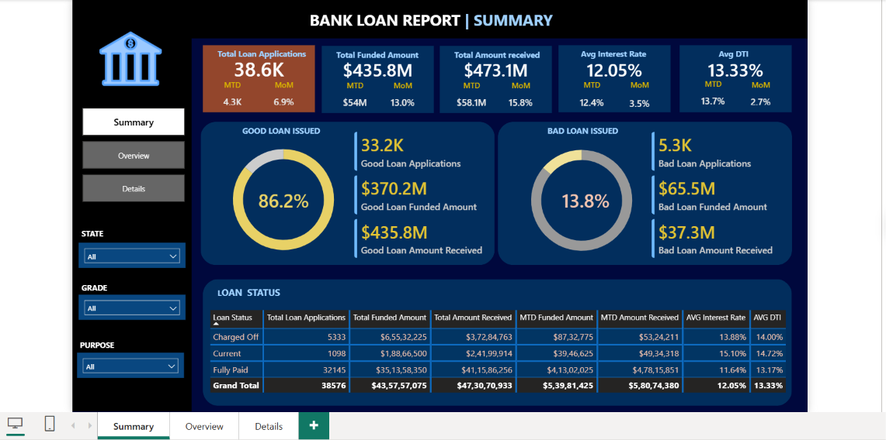
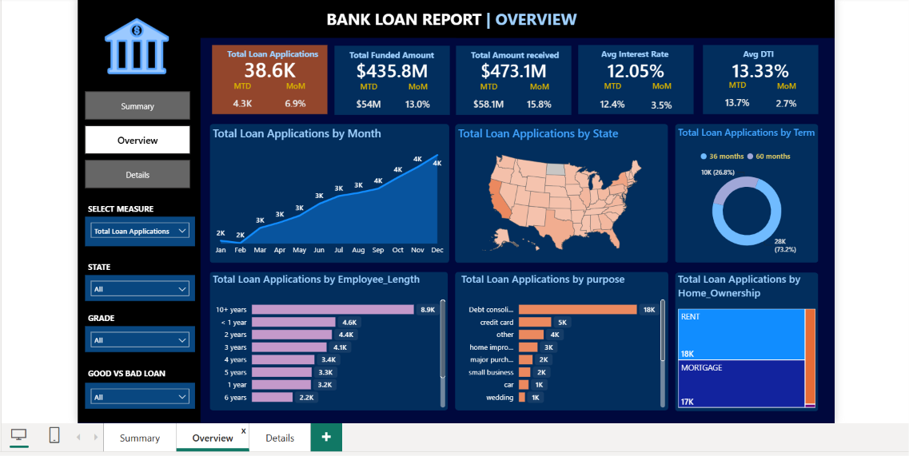
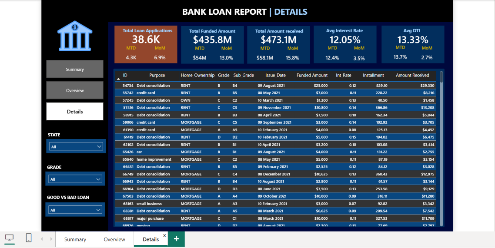

# 🏦 Bank Loan Analysis

## 📌 Project Overview
This project focuses on analyzing bank loan data to understand lending performance, loan quality, funded amounts, and repayment trends. SQL, Python, and Power BI are used to extract, analyze, and visualize financial data to generate meaningful business insights.

## 🎯 Project Objectives
- Analyze total loan applications and loan distribution.
- Evaluate good loans and bad loans.
- Understand funded amounts and total amounts received.
- Identify monthly and regional lending trends.
- Build an interactive Power BI dashboard for business insights.

## 🛠️ Tools & Technologies
- **SQL:** Data querying, aggregations, filtering, and analysis.
- **Python:** Data analysis using Pandas, NumPy, Matplotlib, and Seaborn.
- **Power BI:** Interactive dashboards and visualizations.
- **DAX:** Calculated measures and KPIs.
- **Excel:** Data inspection and analysis.

## 📊 Key Insights
- Analyzed **38,576 loan applications**.
- Total funded amount: **$435.8M**.
- Total amount received: **$473.1M**.
- Good loans: **86.2%**.
- Bad loans: **13.8%**.

## 📈 Power BI Dashboard
The interactive dashboard contains three pages:

1. **Summary:** Overall loan performance and key KPIs.
2. **Overview:** Detailed analysis of loan trends and categories.
3. **Details:** Detailed loan application information.
### 📸 Dashboard Screenshots

#### 1. Summary Dashboard


#### 2. Overview Dashboard


#### 3. Details Dashboard

## 📁 Repository Structure
```text
Bank-Loan-Analysis/
│
├── Dataset/
│   ├── financial_loan.csv
│   └── README.md
│
├── Python/
│   ├── bank_loan_analysis.ipynb
│   └── README.md
│
├── SQL/
│   ├── bank_loan_analysis.sql
│   └── README.md
│
├── Dashboard/
│   ├── Bank-Loan-Analysis.pbix
│   └── README.md
│
├── Dashboard-Screenshots/
│   ├── Summary.png
│   ├── Overview.png
│   ├── Details.png
│   └── README.md
│
└── README.md
```
## 💡 Project Outcome
This project demonstrates practical skills in SQL-based data analysis, Python analytics, financial KPI reporting, and Power BI dashboard development to support data-driven lending decisions.
